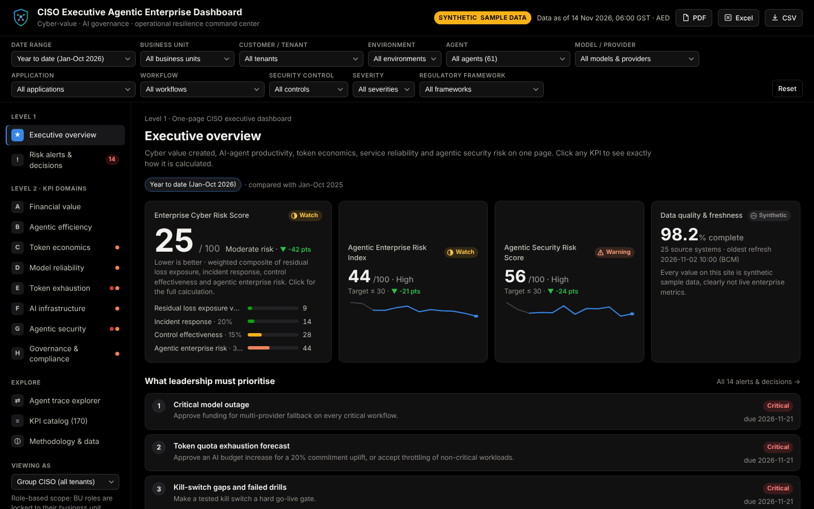
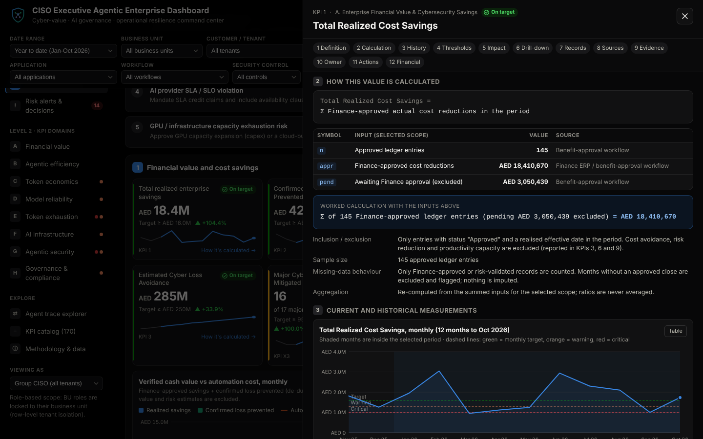

# CISO Executive Agentic Enterprise Dashboard

An enterprise cyber-value, AI-governance and operational-resilience command center for the CEO, CISO, CIO, CTO, CFO, Board Risk Committee, GRC, SOC and AI Governance teams. Black theme, AED by default, and **every value can be clicked to show exactly how it is calculated**.

**Live site:** https://laklubin.github.io/CISO-Executive-Agentic-Enterprise-Dashboard/

> **All figures are synthetic sample data.** They are generated deterministically for demonstration and testing and labelled as such on every page and export. They are not live enterprise metrics.



## Click any KPI to see the calculation

Every KPI card, table row, chart and alert opens a drawer with the definition, the formula, every input with its source, and a worked calculation using the actual numbers for the selected scope. For example:

| KPI | Formula | Worked calculation (YTD Jan-Oct 2026, all BUs) |
|---|---|---|
| Total Realized Cost Savings | Σ Finance-approved actual cost reductions | Σ of 145 Finance-approved ledger entries (pending AED 3,050,439 excluded) = **AED 18,410,670** |
| Agentic Efficiency Gain | (Manual baseline − Agent end-to-end) ÷ Manual baseline × 100 | (38,918,408 min − 13,406,866 min) ÷ 38,918,408 min × 100 = **65.6%** |
| Confirmed Financial Loss Prevented | Gross control claims − duplicate claims | Each incident counted once; control attribution weights sum to 100% |



The drawer has 12 sections: definition; calculation (formula, inputs, worked calculation, inclusion / exclusion rules, sample size, missing-data behaviour); current and historical measurements; target and thresholds; business impact; drill-down (enterprise → BU / customer → application → agent / model → workflow → session → individual event); underlying records (exportable); source systems and last refresh; evidence quality; owner; linked incidents and remediation actions; financial contribution.

## What is in the dashboard

- **Level 1, one-page executive dashboard:** Enterprise Cyber Risk Score (hero), Agentic Enterprise Risk Index, Agentic Security Risk Score, data quality, leadership priorities, and the 20 executive KPI cards in four panels: financial value and cost savings; agentic enterprise efficiency; token economics and AI service reliability; agentic security risk, control gaps and KRIs.
- **Level 2, eight domain dashboards** (A-H) with charts and the full KPI table for each domain.
- **164 KPIs / KRIs + 6 composite indices**, each with definition, formula, unit, sources, frequency, owner, target, warning and critical thresholds, trend, evidence and drill-down.
- **Risk alerts and executive decisions** with severity, affected critical services, owner, business impact, mitigation, remediation deadline and the decision required.
- **Agent trace explorer:** User → Agent → Session → Model → Tool → Action → Resource → Authorization → Result.
- **Filters:** date range (presets + custom months), business unit, customer / tenant, environment, agent, model / provider, application, workflow, security control, severity and regulatory framework. Each KPI shows which filters apply to its data.
- **Role-based scope:** "Viewing as" locks BU roles to their business unit.
- **Exports:** PDF (print), Excel (5 sheets: executive summary, KPI catalog, monthly trend, calculation inputs, alerts) and CSV.

## Data accuracy rules applied

- Finance-approved savings, confirmed loss prevention, estimated risk reduction (FAIR) and productivity capacity are reported separately and never summed.
- An incident's prevented loss is counted once across all contributing security controls.
- Agent efficiency always includes human review, waiting, retries and rework.
- Cached tokens are inside input and reasoning tokens inside output; neither is counted twice. Provider-specific prices are applied per model.
- Provider outages, internal serving failures, gateway / network failures, throttling and client errors are separated. Request-level and business-service availability are tracked separately.
- Control implementation is measured separately from tested effectiveness; framework applicability is determined per BU before scoring.
- Ratios are re-computed from summed numerators and denominators for any scope; missing data is flagged, never imputed.

## Repository structure

```
index.html                 dashboard shell (static, no build step)
assets/css/styles.css      black theme
assets/js/data.js          deterministic synthetic data layer
assets/js/engine.js        filter context, aggregation, thresholds, formatting
assets/js/kpis.js          KPI catalog (164 + 6 composites)
assets/js/charts.js        SVG charts with tooltips and table views
assets/js/xlsx.js          dependency-free Excel writer
assets/js/app.js           pages, calculation drawer, drill-down, alerts, exports
docs/                      deliverables (catalog, dictionary, architecture, schema, ...)
data/                      synthetic dataset exports (CSV) for testing
scripts/build-docs.js      regenerates docs/01-02 and data/ from the code
scripts/monthly-report.js  monthly executive report (Markdown + CSV)
reports/                   generated monthly reports
tests/formulas.test.js     validation tests for formulas, costs and calculations
```

## Run, test and regenerate

```bash
python3 -m http.server 8080
```

Then open http://localhost:8080.

```bash
node --test tests/formulas.test.js
```

```bash
node scripts/build-docs.js
```

```bash
node scripts/monthly-report.js 2026-10
```

## Deliverables

| # | Deliverable | Where |
|---|---|---|
| 1 | One-page CISO executive dashboard | `index.html` (Executive overview) |
| 2 | KPI / KRI catalog (164 indicators + composites) | [docs/01-kpi-catalog.md](docs/01-kpi-catalog.md), KPI catalog page |
| 3 | KPI formula / data dictionary | [docs/02-formula-data-dictionary.md](docs/02-formula-data-dictionary.md) |
| 4 | Logical and physical data architecture | [docs/03-data-architecture.md](docs/03-data-architecture.md) |
| 5 | Required log fields and telemetry mappings | [docs/04-telemetry-mapping.md](docs/04-telemetry-mapping.md) |
| 6 | Database / schema design | [docs/05-database-schema.sql](docs/05-database-schema.sql) |
| 7 | Integration specifications and API connectors | [docs/06-integrations.md](docs/06-integrations.md) |
| 8 | Data ingestion and processing workflows | [docs/07-ingestion-workflows.md](docs/07-ingestion-workflows.md) |
| 9 | Dashboard visual components and drill-down pages | `assets/js/app.js`, `assets/js/charts.js` |
| 10 | RAG threshold and alerting logic | [docs/08-alerting-rag-logic.md](docs/08-alerting-rag-logic.md) |
| 11 | Risk and financial attribution methodology | [docs/09-attribution-methodology.md](docs/09-attribution-methodology.md) |
| 12 | Role-based access and multi-tenant isolation | [docs/10-rbac-multitenancy.md](docs/10-rbac-multitenancy.md) |
| 13 | Sample synthetic dataset for testing | [data/](data/), `assets/js/data.js` |
| 14 | Validation tests for formulas, costs and calculations | [tests/formulas.test.js](tests/formulas.test.js) |
| 15 | Production deployment, monitoring and maintenance | [docs/11-deployment-operations.md](docs/11-deployment-operations.md) |

## Publishing on GitHub Pages

The site is served from the `main` branch root (`.nojekyll` disables Jekyll processing). In the repository settings: **Settings → Pages → Build and deployment → Source: Deploy from a branch → Branch: `main` / `(root)` → Save.**
