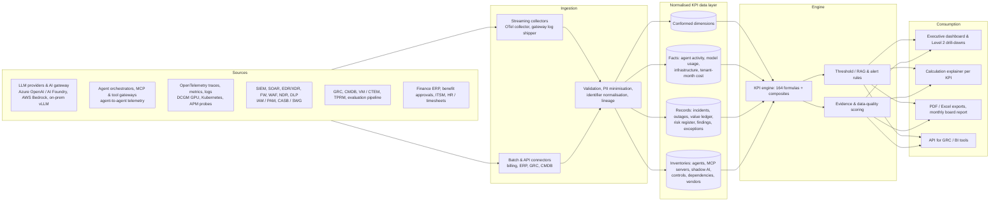

# Logical and physical data architecture

This document describes the target production architecture behind the dashboard. The published site runs the **same KPI engine** (`assets/js/engine.js` + `assets/js/kpis.js`) against a deterministic synthetic data layer (`assets/js/data.js`). In production that module is replaced by the normalised KPI data layer described here, which keeps the same fact and record shapes.

## 1. Design principles

1. **One normalised KPI layer, many sources.** Every source is mapped into conformed dimensions and a small set of facts and records. KPIs never query a source system directly.
2. **Additive facts, re-computed ratios.** Facts store counts, minutes, tokens and AED at the lowest useful grain. Every ratio is computed from summed numerators and denominators for the selected scope, never averaged.
3. **Flow vs snapshot.** Flow facts (tasks, tokens, cost, incidents) are summed over a period. Snapshot facts (inventories, coverage, headroom) are read at period end, with effective-dated rows (SCD type 2).
4. **Evidence first.** Every record keeps a pointer to its evidence (trace ID, ticket, GL posting, approval ID) and its source system, so any KPI can be drilled to the individual event.
5. **Separate value types.** Finance-approved savings, verified prevented loss, FAIR risk estimates and productivity capacity live in different tables and are never summed together.
6. **Data residency and minimisation.** Telemetry stays in-country (UAE region / on-prem). Prompt and completion text is **not** stored in the KPI layer; only metadata, classifications, hashes and token counts.

## 2. Logical architecture

## 3. Data model (star schema)

### Conformed dimensions

| Dimension | Key | Notes |
|---|---|---|
| `dim_date` / `dim_month` | `date_key`, `month_key` | Reporting calendar; GST (UTC+4). |
| `dim_business_unit` | `bu_id` | Holds the fully loaded hourly rate (AED). |
| `dim_tenant` | `tenant_id` | Customer / subsidiary; row-level security key. |
| `dim_application` | `application_id` | Business application hosting agents. |
| `dim_workflow` | `workflow_id` | Manual baseline minutes, criticality, risk tier, BIA cost per minute. |
| `dim_agent` (SCD2) | `agent_id` | Owner, autonomy level, identity, kill switch, trace, SIEM, threat model, risk assessment dates. |
| `dim_model` | `model_id` | Provider, region, residency, price per million tokens (input / cached / output), SLO. |
| `dim_provider` | `provider_id` | Azure OpenAI, AWS Bedrock, on-prem serving, others. |
| `dim_tool` / `dim_mcp_server` | `tool_id`, `mcp_server_id` | Registered flag, scopes, owner. |
| `dim_component` | `resource_id` | GPU clusters, Kubernetes, gateway, network, storage, vector DB. |
| `dim_control` / `dim_framework` | `control_id`, `framework_id` | Control catalog and framework applicability per BU. |
| `dim_security_control_family` | `control_family` | SOC, SIEM, SOAR, EDR/XDR, Firewall, WAF, NDR, DLP, IAM/PAM, CTEM, VM, DFIR, Backup, Cloud, AppSec, GRC, AI Agents. |
| `dim_cost_center` | `cost_center` | Finance mapping for allocations. |

### Facts

| Fact | Grain | Main measures |
|---|---|---|
| `fact_agent_activity` | month (or day) × agent × model × environment | tasks, outcomes, autonomy, minutes (manual, exec, review, wait, retry, rework), tokens (in, cached, out, reasoning, waste), cost, requests by outcome class, fallback, tool calls, authorisation, prompt injection, sensitive data, cross-border, loops |
| `fact_model_request_hourly` | hour × model deployment × region | eligible requests, failures by class, latency histogram buckets, TTFT buckets |
| `fact_infra_component` | hour / month × component | requests, successes, GPU-hours, utilisation, memory pressure, failures, node-hours, pods, DR tests, monitored assets, cost |
| `fact_tenant_month` | month × tenant | allocated infra / licence / platform / labour cost, budgets, DLP, FTE, cases, users, shadow-AI users, automation coverage |

### Records (event level, drill-down targets)

`rec_incident`, `rec_incident_control_attribution`, `rec_value_ledger`, `rec_outage`, `rec_risk_scenario_snapshot`, `rec_quota_snapshot`, `rec_model_change`, `rec_eval_run`, `rec_audit_finding`, `rec_agent_finding`, `rec_risk_exception`, `rec_kill_switch_drill`, `rec_agent_session` and `rec_agent_span` (trace).

The DDL is in [`05-database-schema.sql`](05-database-schema.sql).

## 4. Physical architecture options

| Layer | Azure-centric | AWS-centric | On-prem / sovereign |
|---|---|---|---|
| Streaming ingest | Event Hubs, Azure Monitor diagnostic settings | Kinesis Data Streams / Firehose, CloudWatch Logs subscriptions | Kafka, OpenTelemetry collector |
| Batch / API | Data Factory, Logic Apps | Glue jobs, Step Functions, Lambda | Airflow / Dagster |
| Storage | ADLS Gen2 (UAE North) | S3 (me-central-1) | Object storage (MinIO / Ceph) |
| KPI store | Azure Data Explorer, Fabric warehouse or PostgreSQL | Redshift, Athena + Iceberg or Aurora PostgreSQL | PostgreSQL / ClickHouse |
| SIEM linkage | Microsoft Sentinel (Log Analytics) | Splunk / OpenSearch | Splunk |
| Serving | Static web app + API (App Service / Functions) | S3 + CloudFront + API Gateway | NGINX + API service |
| Identity | Entra ID (SSO, MFA, groups → roles) | IAM Identity Center | Keycloak / AD FS |

Recommended baseline for a UAE group: in-country object storage + PostgreSQL (row-level security) for the KPI layer, the SIEM as the security-telemetry system of record, and the static dashboard served behind SSO.

## 5. Latency tiers

| Tier | Latency | Examples |
|---|---|---|
| Streaming | < 5 min | Gateway requests, tokens, 429s, guardrail verdicts, tool authorisation, traces |
| Near real time | 5-60 min | SIEM / SOAR incidents, DLP, CASB, model outages |
| Daily | 24 h | Provider billing, CMDB, vulnerability / CTEM, GRC findings, evaluations |
| Monthly | Month close | Finance-approved savings, allocations, budgets, FAIR risk register |

Each KPI shows the freshness of its slowest source ("KPI last refreshed").

## 6. Identifier normalisation

All facts and records carry the normalised identifiers: **agent ID, model and provider ID, business unit / customer ID, application ID, workflow ID, task ID, session ID, trace ID, tool and MCP server ID, cloud / infrastructure resource ID, incident ID, control ID, risk ID, cost centre, timestamp and reporting period.** A crosswalk table (`map_source_identifier`) maps every source-native ID (API key, service principal, Kubernetes pod label, CMDB CI, ERP cost centre) to the canonical ID. Unmapped identifiers raise data-quality alerts and are surfaced as shadow-AI candidates when they relate to LLM API traffic.

## 7. Data quality controls

- Schema and range validation at ingestion; quarantine for rejects.
- Reconciliation: gateway tokens vs provider billing (±2%), ledger vs GL, incident counts SIEM vs SOAR.
- Completeness per source is computed daily and shown on every KPI ("Evidence quality").
- Missing data is **never imputed**; affected KPIs show reduced completeness and lower confidence.
