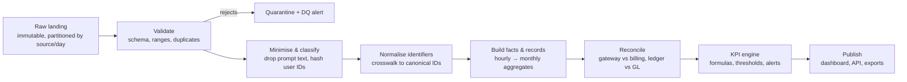

# Data ingestion and processing workflows

## 1. Pipeline stages

## 2. Schedules

| Workflow | Trigger | Output |
|---|---|---|
| Gateway / OTel stream | Continuous | Hourly `fact_agent_activity` partitions |
| Security events | Every 5-15 min | `rec_incident`, attribution, DLP / CASB counters |
| Infrastructure metrics | Every 5 min, rolled up hourly | `fact_infra_component` |
| Provider billing & quota | Daily 23:00 GST; quota every 15 min | Cost reconciliation, `rec_quota_snapshot` |
| Governance (GRC, registry, CMDB, TPRM) | Daily 02:00 GST | Inventories and control tests |
| Finance close | Monthly (working day 5) | Approved savings, allocations, budgets |
| Risk register | Monthly | FAIR snapshot |
| KPI build | Hourly; full rebuild nightly | KPI values, series, alerts |
| Monthly board report | Working day 6, 08:00 GST | PDF / XLSX report pack |

## 3. Processing rules

- **Idempotent loads**: natural keys + watermarks; re-running a window replaces it.
- **Late data**: windows stay open for 72 hours (security / telemetry) and until month close (finance). KPIs for open windows are flagged provisional.
- **Back-fill**: replay from raw landing with the connector version in force at the time.
- **Allocation**: shared infrastructure and licence cost allocated to tenants by token share; automation platform and labour by task share. Allocations always sum to the platform total (tested).
- **Baselines**: manual baselines are versioned per workflow; a task uses the baseline valid on its date.
- **Price list**: model prices are effective-dated; cost is computed with the price valid on the request date.

## 4. Data-quality checks

| Check | Rule | Action on failure |
|---|---|---|
| Completeness | ≥ 98% of expected records per source / hour | Lower evidence quality on dependent KPIs; DQ alert |
| Timeliness | Source freshness within its cadence SLA | Freshness badge turns amber / red |
| Referential integrity | All IDs resolve in the crosswalk | Unmapped LLM traffic → shadow-AI candidate; others quarantined |
| Subset rules | cached ≤ input, reasoning ≤ output, succ + fail + escal = tasks | Reject record |
| Reconciliation | Gateway vs provider billing within ±2%; ledger vs GL exact | Block publication of affected cost KPIs |
| Attribution | Control weights per incident sum to 100% | Reject attribution set |
| Outliers | Values beyond 6σ of trailing 90 days | Hold for review, publish with flag |

## 5. Lineage and audit

Every KPI value stores the build ID, input record counts, source freshness and engine version, so a published number can be reproduced exactly. The dashboard's "How this value is calculated" drawer displays the same inputs.
